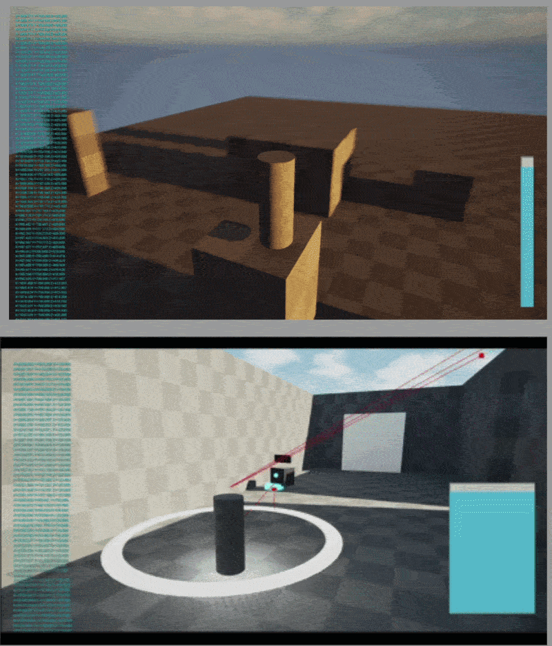

## Summary

| Role | Game Designer / Systems Designer |
|---|---|
| Team | 20 |
| Engine | Unreal Engine 5.7.4 |
| Target Platform | PC |
| Repo | Perforce <!-- TODO: link the repo --> |
| Duration | 1 year |

## About
*Lantern of Souls* is the 2027 capstone project from Brigham Young University's Animation and Games Department. This stealth horror game casts you as Thiago, a soul master tasked with guiding a lost soul through the labyrinthine ruins of an underworld temple toward its next life.

But Thiago is not alone. Restless souls haunt the temple's halls, and he must rely on his knowledge and the power of the soul he carries to slip past them, light the braziers, and illuminate the way home.

Developing over the course of a year by a team of eight designers and programmers and 12 artists.

**Project Focus:** Long-term project design · Iteration · Finding the fun

(For more design based breakdowns see my case studies on Snowball Showdown and Lichtenauer. For Technical Breakdowns look at Emily's Interior Design Co.)


**Warning!** This article is still a work in progress, you may look at it, but know this isn't the finished product.


## Timeline
*Lantern of Souls* is a year-long project, and at the five-month mark, after many rounds of iteration, we've found our direction and built something that's genuinely fun to play. Here's the journey so far, and how we've iterated our way toward the fun.

**A note on "we":** Everyone on the design and programming team was involved in the design process for almost every part of the game, especially early on. As design lead, I took part in every area, so I'll write about the team's decisions as "we" and call out my own contributions where they apply.
### Where we began (Months 1-3)
#### The Pitch

  <a href="https://docs.google.com/presentation/d/1baIBm49Z3-1zA4lFZKd_H-bpf3PipMgu-qrNQgqMfxE/edit?slide=id.g3ae52c7ded1_0_0#slide=id.g3ae52c7ded1_0_0">Read the original pitch deck by Mailen Cruz</a>

*Lantern of Souls* began as a pitch from Mailen Cruz. These were its pillars:

- **Fantasy:** *"A third-person stealth and adventure game where players assume the role of the Soul Master, a guardian charged with escorting a fragile soul through a ruined temple inhabited by hostile spirits drawn to its light. The challenge is to move and make decisions based on the state of the soul."*
- **Light management:** Light is a constantly running timer and the core risk-versus-reward mechanic. Bright light is safer for pathfinding but attracts enemies, while dim light offers stealth but risks the soul's extinction.
- **Stealth:** The other core mechanic. Players sneak so wanderer spirits can't see them.
- **Tone:** *"Dark, mysterious, atmospheric."*

#### First Prototype: April 5, 2026
The design team met outside of class to hear Mailen's pitch again and talk through our questions.

  <a href="https://docs.google.com/document/d/1cSk81gbBJcOGumR_T_1kBP8TQC8zSHuAaFoBujBOD8c/edit?usp=sharing">Read the meeting minutes</a>

**Problem:** The pitch says the game is about retaining light, but we didn't know what that would feel like to play.

**Solution:** On April 27, we started a rough demo with light as a bar the player had to preserve. A sprint and a crouch both drained light, and light stations recharged it. Simple cube enemies patrolled, and the game reset if the player's light radius overlapped one. I built the light radius, the sprint, and the crouch.

**Outcome:** The demo was decently fun, but too punishing. The sprint could drain the player's light almost instantly, so it felt like a trap instead of a tool.

**Takeaway:** Light drain had to feel like a resource to manage, not a penalty for acting.



#### First Meeting In Class: May 4, 2026
We played the demo with our teacher and came up with the core questions we needed to answer.



  <a href="https://docs.google.com/document/d/1ln9ed2PbmXWfgF69FPzjwGj-ce-VkWydbgJMqWOxPFc/edit?usp=sharing">Read the meeting minutes</a>

**Vision:** Make stealth fun through quick thinking, suspense, and intelligent choices, with a player who feels proactive instead of like a victim.

**Problems:**
- How do we make enemies the challenge, and how are they tied to light?
- What are the player's action verbs, and how do they enable intelligent choices?
- How is the player visible to enemies?

**Solutions:**
- Improve the AI so enemies can pursue the player instead of causing an instant death, and add a perception component so they don't detect the player just by overlapping.
- Test a range of player abilities.
- Start exploring sub-objectives, like doors that light opens for a limited time.

**What I worked on:** I wanted the sprint and crouch to feel good before moving on to anything else. Crouching now shrinks the light radius but slows movement, with no light cost, since waiting already drains light. Sprinting no longer drains light either, because being more detectable is its own drawback.

**Outcome:** The game was better. Enemies felt more dangerous with the perception component, and players weren't punished for using their tools. We tried many abilities and scrapped most of them, including a Light Pulse. Two survived: a **Distraction** (a small object you leave behind to lure enemies) and the **Shadow Dash** (dash through enemies undetected, at a small light cost).

**Takeaway:** The abilities needed refinement, enemies needed to feel fairer because it was hard to tell how far they could see you, and we still needed a core game loop.

**The first core loop:** The player enters an area and solves puzzles, some environmental and some about avoiding enemies. If spotted, the player can run and return later, or deliberately lure an enemy to specific spots to trigger certain puzzles.





#### Preproduction Class and Into the Summer
As preproduction class went on, we narrowed our open questions to three:
1. What is the player-enemy interaction?
2. What are our core abilities, and how can we make them more streamlined and intuitive?
3. How do we condense our core experience into a quick vertical slice?

**Direction:** We understood the game as an adventure stealth game with one caveat: the protagonist can't kill or attack enemies. Mailen, who wrote the pitch and later became the project's director, confirmed this.

**Research:** We studied *Aragami*, *Splinter Cell: Chaos Theory*, *Thief 2*, *Hitman: World of Assassination*, *Metal Gear Solid V*, *Dishonored*, *Metroid Dread*, and *Mark of the Ninja*. Four findings shaped our decisions:
- **Operating in the dark didn't feel good.** Players liked having the information to make informed choices.
- **Enemies had states.** They patrolled or stood guard, then detected the player after a grace period. Players could watch, then act.
- **Nearly every game had a distraction**, either to take heat off the player or to create an opening.
- **Slow, methodical play** mattered even more given our no-killing rule. We didn't want players running and gunning through a level.

**What I worked on:** The Shadow Dash, the crouch and sprint balance, and levels. I'll walk through the Shadow Dash in detail to show my iteration process.

- **The Shadow Dash:**
    1. **Phase 1 (May 18, 2026):** The goal was a movement option that makes the player undetectable. I got it to where, with good timing, the player could phase through an enemy unseen. Players liked it, but it felt uncontrollable. They were just hitting a button to speed away, which isn't methodical.

        
        

    2. **Phase 2 (May 25, 2026):** Inspired by the teleports in *Aragami* and *Dishonored*, I let the player aim the teleport and release it to a spot of their choosing. Players loved the control, and the other games showed that teleporting to high and low places gives players vantage points.
    3. **Phase 3 (June 2-8, 2026):** I added teleporting down, and Becca Ellingston added teleporting up, so players could teleport anywhere they could see. It quickly became a core element, and I spent the following week polishing it, such as keeping the player from clipping into walls during a teleport.

        

    The Shadow Dash was a core element of this build, but it was later replaced. I'll cover why in a later section.

- **Crouch and sprint:** Even after I shrank their radii, players couldn't tell how close they could get to an enemy before being detected. I added a circle that scales with the light radius so they can see when they overlap an enemy. Once detection was visible, the sprint was too easy, so I scaled its radius back up.

    

- **Levels:** I wanted to experiment with *gameplay gardens*, a concept I learned from the creator of *Bloodthief*: small, self-contained rooms built around one specific experience. I built several, and the two-story room taught me the most.
    - **Close encounters:** Players crouch behind a low barrier while an enemy circles it. It was fun, but too linear.
    - **The two-story room:** Guards patrol both floors, and the player can teleport to walkways on the lower level, but can't stay there because upstairs enemies can pass through them.
        - Players almost always went upstairs, since it had three guards to the lower floor's five. They liked having multiple ways to finish a puzzle, which was part of the original pitch.
        - I changed the enemy count downstairs and removed a ramp upstairs, but it always ended up too trivial or too punishing.

             
    - **The library:** A two-story room where the player takes a key from under a watcher, then sneaks to a second-floor walkway to unlock the exit. The layout was a hit, but players kept brute-forcing it.

**Other things the rest of the team built:**

**Player abilities:** Besides the Shadow Dash, we had the Distraction. If it overlapped an enemy's vision cone, the enemy would walk over and eat it, so players could lure enemies to specific points on the map and use them to activate puzzles. It needed work, but that was the least of our worries.

**Enemies:**
- **The Guard:** A basic enemy that patrols a route or stands in one spot, sometimes with a key on its back as a sub-objective.
- **The Watcher:** A living spotlight that drains the player's light when it sees them. It became the highlight of many levels.
- **The Hunter:** Players found the Guard too trivial, so Logan, our tech artist and game designer, made the Hunter to act as the player's equal in intelligence. It's planned as a mid-game mini-boss and a final test of everything learned.

The team built much more than this, including levels, enemies, and player systems, but this is enough for the summary.

**End of month three:** Our gardens were decently fun, but one problem was nagging the team. The core loop we'd decided on months earlier existed. We had our abilities, players could learn them, and we could build levels that took about ten minutes to play. But there was a glaring problem with the **player-enemy interaction**.

### The Turning Point
It was mid June...

## Ongoing documentation:
I will be adding documentation here soon with more breakdowns on design decisions, reasoning and player experience